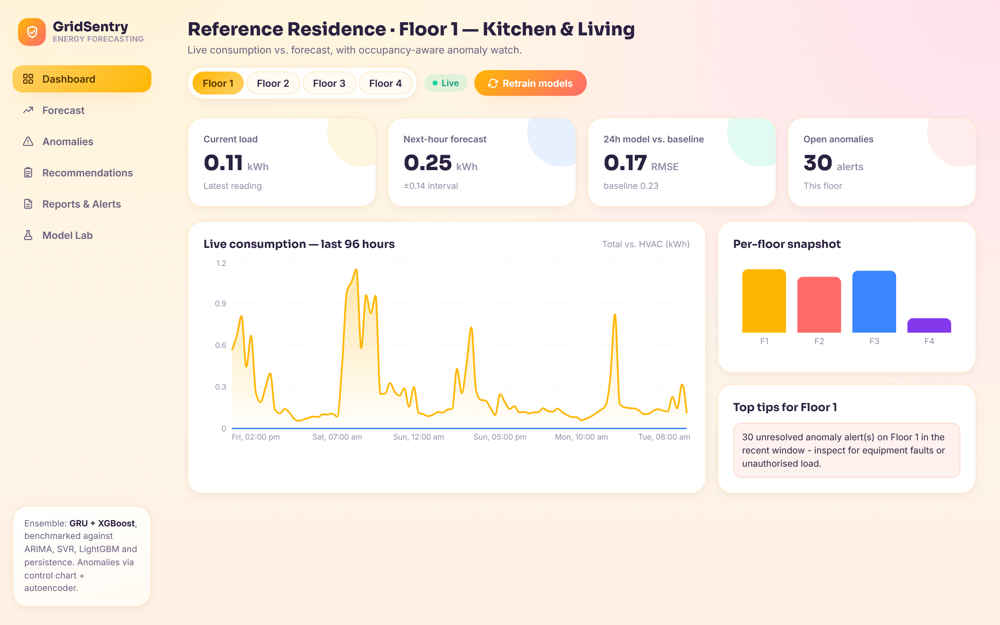
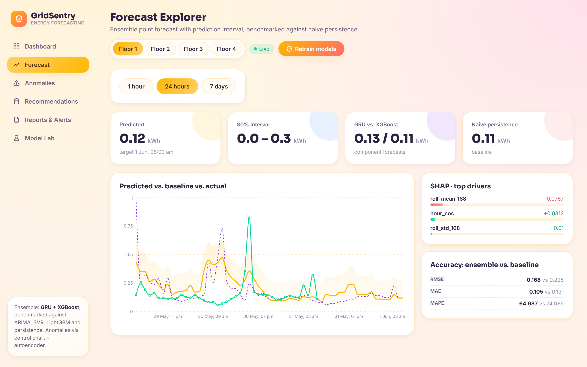
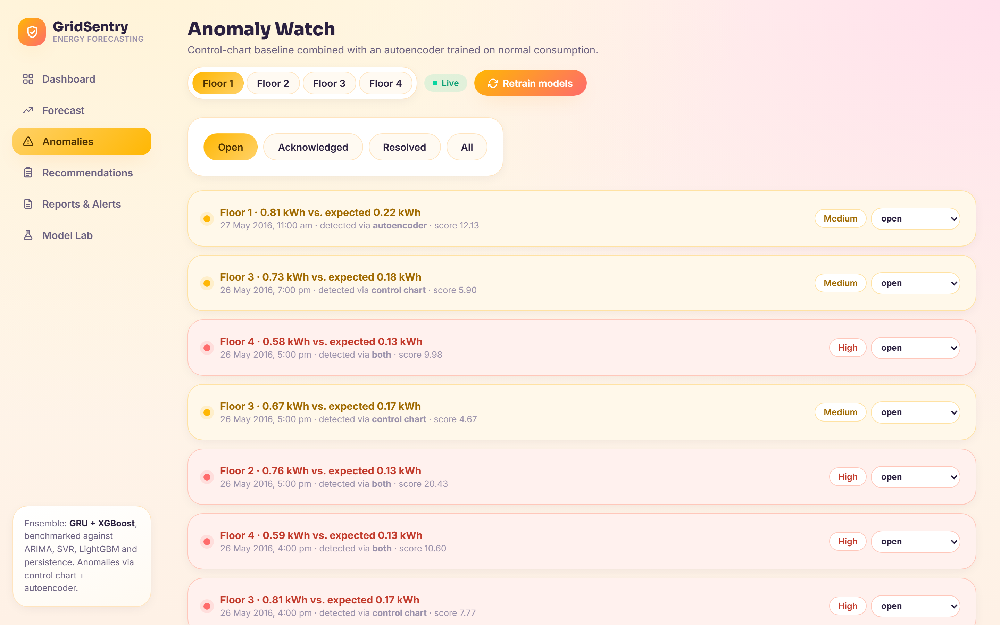
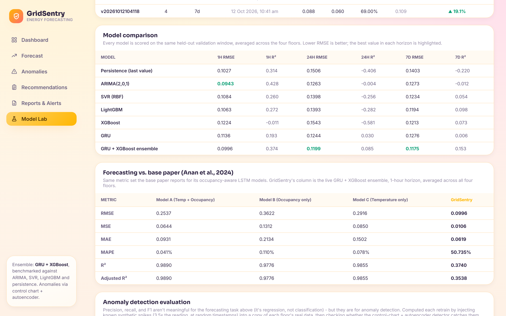
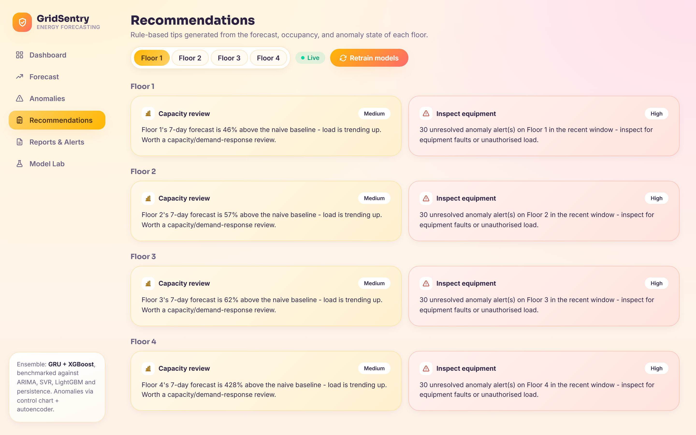

# GridSentry

 

**Occupancy-aware energy consumption forecasting for smart buildings** — Capstone project, MIT-WPU.

Forecasts a building's electricity use 1 hour, 24 hours, and 7 days ahead with a GRU + XGBoost ensemble, flags anomalies with a control-chart + autoencoder, and serves it through a FastAPI backend and React dashboard.

## Screenshots

| Dashboard | Forecast Explorer |
|---|---|
|  |  |

| Anomaly Watch | Model Lab |
|---|---|
|  |  |



## Data

Runs on the real, public **[UCI Appliances Energy Prediction](https://doi.org/10.24432/C5VC8G)** dataset (a real house in Belgium, Jan–May 2016). 
The single real meter is split into 4 zones using each zone's own real room-sensor activity, so every floor traces back to genuine measurements rather than invented numbers:

| Floor | Zone |
|---|---|
| 1 | Kitchen & Living |
| 2 | Utility & Office |
| 3 | Bath & Ironing |
| 4 | Bedrooms |

`hvac_kwh`/`elevator_kwh` are `0` (this house has neither); `occupancy` is an inferred proxy, not a sensor reading. Once the real May-2016 timeline runs out, a scheduled tick keeps the dashboard live by replaying each floor's own reading from a week earlier with jitter.

The same download → hourly resample → zone split pipeline, plus a full exploratory data analysis,
is also available as a standalone, runnable notebook:
[`notebooks/GridSentry_Preprocessing.ipynb`](notebooks/GridSentry_Preprocessing.ipynb)
(open it in Colab or Jupyter). It saves its output to `notebooks/data/processed/gridsentry_readings.csv`.

A second notebook, [`notebooks/GridSentry_Model_Training.ipynb`](notebooks/GridSentry_Model_Training.ipynb),
trains the same GRU + XGBoost ensemble and anomaly detector the app uses - for every floor and
horizon - and compares the results against the base paper's published numbers (Anan et al., 2024).

## What it implements

- **Forecasting** — GRU + XGBoost ensemble, blended by validation RMSE, with SHAP explainability (`backend/app/models/`)
- **Model comparison** — ARIMA, SVR, LightGBM and naive persistence scored on the same validation window as the ensemble, shown in the Model Lab (`backend/app/models/baselines.py`)
- **Anomaly detection** — control chart + autoencoder (`backend/app/anomaly/`)
- **Recommendations** — rule-based tips grounded in each floor's historical climatology (`backend/app/services/recommendation.py`)
- **Alert dispatcher** — emails or texts (SMS webhook) when a new high-severity anomaly appears, rate limited per floor and per hour (`backend/app/services/alerts.py`)
- **Report builder** — weekly consumption, anomaly and forecast-accuracy summary as PDF or CSV, saved every Monday 06:00 (`backend/app/services/reports.py`)
- **API** — FastAPI over SQLite: `/forecast`, `/anomalies`, `/recommendations`, `/alerts`, `/reports`, `/retrain`, ... (`backend/app/routers/`)
- **Scheduler** — nightly retraining, anomaly re-scans, live-ingestion tick, weekly report (APScheduler, `main.py`)
- **Dashboard** — React + Recharts (`frontend/src`)

Architecture diagram: [`docs/GridSentry-Architecture.drawio`](docs/GridSentry-Architecture.drawio) ([PNG](docs/GridSentry-Architecture.png))

## Running it

One command sets up and starts everything (venv, dependencies, database seed, both servers) and
opens the dashboard in your browser:

```powershell
./run.ps1      # Windows
```

```bash
./run.sh       # macOS / Linux
```

Re-running it is safe — it skips steps that are already done (existing venv, installed
dependencies, seeded database) and just starts the servers.

<details>
<summary>Manual setup, if you'd rather run each step yourself</summary>

```bash
# Backend
cd backend
python -m venv .venv
.venv/Scripts/pip install -r requirements.txt
.venv/Scripts/python seed.py            # downloads data + trains models (a few minutes)
.venv/Scripts/uvicorn app.main:app --host 127.0.0.1 --port 8000

# Frontend (separate terminal)
cd frontend
npm install
npm run dev
```

</details>

Open `http://localhost:5173` — the frontend expects the API at `http://127.0.0.1:8000`.
The interactive API docs are at `http://127.0.0.1:8000/docs`.

## Docker

```bash
docker compose up --build
```

The dashboard is then at `http://localhost:8080` and the API at `http://localhost:8000`. The first
start downloads the dataset and trains the models into the `gridsentry-data` volume, which takes a
few minutes; later starts reuse it. The compose file passes the optional alert settings below
through from your environment.

## Tests

```bash
cd backend
.venv/Scripts/pip install -r requirements-dev.txt
.venv/Scripts/python -m pytest
```

The suite covers the metrics, feature engineering, the zone split, the anomaly detector, the
ensemble, the comparison models, the alert dispatcher, the report builder and the REST API. It runs against a throwaway database (see `GRIDSENTRY_ARTIFACTS_DIR`
below) and needs no network access, so it never touches your seeded data.

## Configuration

| Variable | Default | Purpose |
|---|---|---|
| `GRIDSENTRY_ARTIFACTS_DIR` | `backend/artifacts` | Where the SQLite database, saved models and reports live |
| `GRIDSENTRY_CORS_ORIGINS` | none | Extra comma-separated origins allowed to call the API |
| `GRIDSENTRY_SMTP_HOST`, `_PORT`, `_USER`, `_PASSWORD`, `_FROM` | none, port 587 | SMTP server for alert emails |
| `GRIDSENTRY_ALERT_EMAIL_TO` | none | Comma-separated alert recipients |
| `GRIDSENTRY_SMS_WEBHOOK_URL`, `GRIDSENTRY_SMS_TO` | none | HTTP endpoint that sends texts (receives JSON `{to, message}`) and the numbers to text |
| `GRIDSENTRY_ALERT_COOLDOWN_MIN` | `60` | Minutes before the same floor can alert again |
| `GRIDSENTRY_ALERT_MAX_PER_HOUR` | `6` | Most alerts the whole building can send per hour |
| `VITE_API_URL` | `http://127.0.0.1:8000` | API address the frontend calls (set at build time) |

With no email or SMS settings, alerts are still raised and appear in the alert log on the
Reports & Alerts page, they just aren't sent anywhere.

## Project info

See [CHANGELOG.md](CHANGELOG.md) for release history, [CONTRIBUTING.md](CONTRIBUTING.md)
for how to contribute, and [LICENSE](LICENSE) for terms of use.


